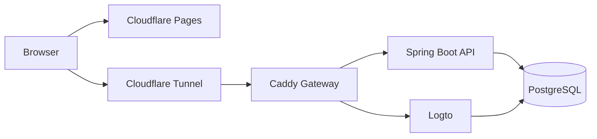

## Overview

PropMange is a property management system that brings property managers, landlords and tenants into one application, covering properties, leases, tenant access and communication. It was built as a learning project, in a domain large enough to need real authorization and data ownership, for learning Spring Boot, PostgreSQL and self-hosting a complete production stack. It supports many organizations rather than a single landlord. It was built with AI assistance, with most of the code generated and every change reviewed by hand.

The system is built as a combination of self-hosted, containerized components:

:::terms

- **Web App**: A React single-page application, hosted on Cloudflare Pages, that keeps working offline.
- **API**: A Spring Boot REST API that holds all business rules and authorization.
- **Identity Provider**: A self-hosted Logto instance that signs users in and issues their tokens.
- **Gateway**: A Caddy reverse proxy behind a Cloudflare Tunnel, the only route into the stack.
- **Database**: A single PostgreSQL server holding separate databases for the API and the identity provider.

:::

## How It Runs

The page is served from Cloudflare's edge, while everything behind it runs on a self-managed machine. Getting those two halves to work together, and keeping the app usable when they can't reach each other, is the centre of the project.

### The Stack

Everything except the web app runs as one Docker Compose stack: the database, the identity provider, the gateway, the API and the tunnel. The whole stack comes up from a single command.

No ports are opened to the internet. The Cloudflare Tunnel makes an outbound connection to Cloudflare, which routes public traffic back through it to the gateway. The API, the identity provider and the database sit on the stack's internal network, reachable only through the gateway.

### Gateway and Sign-In

Sign-in uses OIDC (OpenID Connect) against the self-hosted Logto. The web app sends the user to Logto directly, and Logto returns a signed token that the app then attaches to every API request. The API never sees a password. It only checks that each token was signed by Logto and is still valid.

Caddy is what lets one machine serve both. It routes by hostname: requests for the sign-in domain go to Logto, and requests for the API domain go to the Spring Boot API. Encryption ends at Cloudflare's edge, so Caddy forwards the original public address to Logto, keeping the tokens it issues valid for the public sign-in domain the API expects.

:::info

The API checks tokens against Logto over the internal network, so validating a request never depends on a round trip out through the tunnel.

:::

### Offline-First Web App

The web app treats the network as optional. Everything it loads is cached on the device, so pages open and read normally without a connection. Changes made offline appear immediately and are kept in a queue on the device until they can be sent.

The browser assigns every new record its own ID at creation, rather than waiting for the server to issue one. That means a property created offline can be opened, edited and given units before it has ever reached the server, and every queued change still points at the right record when it's replayed.

:::steps

1. **Change**: The user makes a change, and the app shows the result immediately as pending sync.
2. **Queue**: The change is saved on the device, so it survives closing the tab or reloading the page.
3. **Reconnect**: When the app regains a connection, it confirms the API is actually reachable, not just that the browser reports being online.
4. **Replay**: Queued changes are sent to the API.
5. **Refresh**: The app refetches from the server, and the server's state becomes the source of truth.

:::

If a change is rejected when it's replayed, the app rolls the screen back to its previous state.

## The Application

### Organizations and Access

Every property belongs to an organization, and one person can belong to several organizations with a different role in each. Their access is described by **permission policies**: named sets of permissions, such as which actions a person can take on leases or tenants. Policies are assigned at the organization, property or unit level and apply to everything beneath that point. A manager can be given one building without seeing the rest of the portfolio.

Multi-organization support was designed in from the start, and it shapes every request, since each one is checked against the person's access for the organization and the exact property or unit it touches.

### Properties, Units and Leases

Properties contain units, and a unit's availability follows its lease: activating a lease marks the unit occupied, and ending one frees it again. Properties and units with active leases can't be deleted.

A lease moves through a fixed lifecycle, from draft through review to active, and finally ended, either by termination or automatically at expiry. Only drafts can be edited. Leases are written from **lease templates**, Markdown documents with placeholders for the lease's terms. On activation, the terms are stamped into the lease's own copy, so later changes to the template never alter a lease already in force.

### Tenants and Communication

Tenants get their own portal showing their lease, unit, property and co-tenants, gathered in a single request and cached on the device for a day, since a lease rarely changes and tenants often need it when connectivity is poor.

People join an organization or a lease through emailed invites, which expire if they aren't accepted. Notifications are sent by email in the background, retried if delivery fails, and respect each user's preferences. Significant actions are recorded as an activity trail for each organization.

### Roadmap

The system was designed to connect maintenance crews as well. Maintenance requests, work tickets and messaging between tenants and managers are the next features planned.
